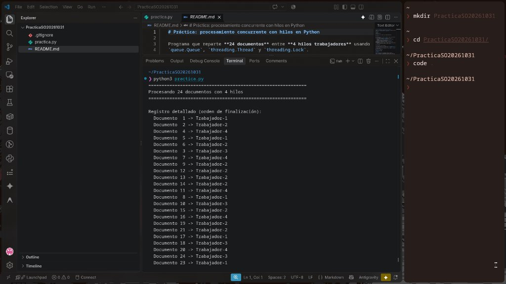
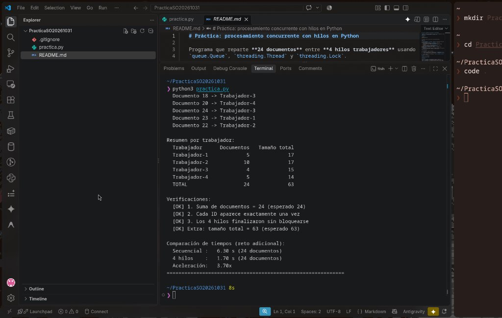

# Práctica: procesamiento concurrente con hilos en Python

Programa que reparte **24 documentos** entre **4 hilos trabajadores** usando
`queue.Queue`, `threading.Thread` y `threading.Lock`.

## Ejecución

```bash
python3 practica.py
```

No requiere librerías externas (solo la biblioteca estándar).

## Qué hace ?

1. Crea 24 documentos `{id, tamaño}` (tamaño 1–5, semilla fija) y los mete en una `queue.Queue`.
2. Lanza 4 hilos (`Trabajador-1` … `Trabajador-4`). Cada uno:
   - intenta obtener un documento con `get_nowait()`;
   - si la cola está vacía captura `queue.Empty` y termina de forma controlada;
   - simula el trabajo con `time.sleep(tamaño * 0.1)`;
   - actualiza el diccionario compartido dentro de `with lock:`.
3. Hace `start()` y `join()` a los 4 hilos.
4. Imprime el registro detallado, el resumen por trabajador y las verificaciones.
5. **Reto adicional:** mide el tiempo, lo compara con una versión secuencial
   y acumula el tamaño total procesado por cada trabajador.

## Verificaciones

| # | Verificación | Cómo se comprueba |
|---|---|---|
| 1 | La suma de documentos por trabajador es 24 | `sum(documentos) == 24` |
| 2 | Cada ID aparece una sola vez en el registro | `sorted(ids) == [1..24]` |
| 3 | Los 4 hilos terminan sin bloquearse | `join()` regresa y `is_alive()` es `False` en todos |

## Capturas de la ejecución

**Registro detallado** (qué trabajador procesó cada documento):



**Resumen por trabajador, verificaciones y comparación de tiempos:**



## Preguntas

**¿Por qué `queue.Queue` es apropiada para compartir trabajos?**
Porque es *thread-safe*: internamente usa sus propios locks, de modo que
`put()` y `get_nowait()` son operaciones atómicas. Dos hilos nunca pueden
obtener el mismo documento ni se puede perder uno. Además `get_nowait()`
combina "comprobar si hay elementos" y "sacar uno" en una sola operación,
evitando la condición de carrera que habría con `if not cola.empty(): cola.get()`
(la cola podría vaciarse entre la comprobación y la lectura y el hilo quedaría
bloqueado para siempre).

**¿Qué protege `Lock` y qué pasaría si se actualizara el resumen sin él?**
Protege la sección crítica donde se modifica el estado compartido: el
diccionario `resumen` (contador y tamaño por trabajador) y la lista `registro`.
Una operación como `resumen[n]["documentos"] += 1` no es atómica
(leer → sumar → escribir); sin el lock, dos hilos podrían intercalarse y
perder actualizaciones (*race condition*), dejando totales incorrectos o
inconsistentes entre contador y tamaño.

**¿Qué cambiarías si cada documento tuviera que guardarse en un archivo real?**
- Sustituir `time.sleep` por la escritura real (`with open(...)`) y manejar
  errores de E/S con `try/except` para que un fallo no mate al hilo.
- Usar un nombre de archivo único por documento (p. ej. `doc_<id>.txt`) para
  que los hilos no escriban en el mismo archivo; si fuera un archivo común,
  proteger la escritura con un lock.
- Llamar a `cola.task_done()` en un `finally` y registrar qué documentos
  fallaron para reintentarlos, manteniendo que cada uno se procese exactamente una vez.
- Como la E/S libera el GIL, los hilos siguen siendo una buena opción
  (o `concurrent.futures.ThreadPoolExecutor`).

## Reto adicional: secuencial vs. 4 hilos

Ejemplo de resultado obtenido:

| Versión | Tiempo |
|---|---|
| Secuencial | ~6.3 s |
| 4 hilos | ~1.7 s |

**¿Por qué la diferencia puede ser pequeña en este ejemplo artificial?**
- El "trabajo" es `time.sleep`, que libera el GIL; por eso aquí sí se nota
  mejora (~3.7x), pero nunca llega a 4x por el reparto desigual: el tiempo
  total lo marca el hilo que más carga acumula y los documentos más grandes al final.
- Con pocos documentos y tareas tan cortas, el coste de crear hilos,
  adquirir el lock y sincronizar pesa proporcionalmente más.
- Si el trabajo fuera de CPU (cálculos en Python puro), el **GIL** impide que
  dos hilos ejecuten bytecode a la vez y la versión con hilos tardaría
  prácticamente lo mismo (o más) que la secuencial; ahí convendría `multiprocessing`.
